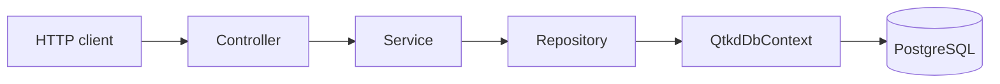

# Phase 2 - QTKD, tuần 05

Ứng dụng ASP.NET Core Web API dùng PostgreSQL để đọc Customer và Contract. Đây là nền cho tuần 06 và 07; dữ liệu nằm trong database, không nằm trong controller.

## Cấu trúc

```text
QTKD.slnx
QTKD.Api/
  Controllers/   # Nhận request, chọn HTTP status
  Services/      # Chuyển entity thành response DTO
  Repositories/  # Truy vấn EF Core
  Data/          # DbContext và migration
  Models/        # Entity ánh xạ bảng
  DTOs/          # Kiểu dữ liệu trả về API
```

Luồng: `HTTP → Controller → Service → Repository → QtkdDbContext → PostgreSQL`, rồi kết quả quay lại theo chiều ngược. `AsNoTracking` dùng cho truy vấn chỉ đọc. `Include(Customer)` lấy tên khách hàng trong phản hồi Contract.



## Chuẩn bị và chạy

Cần .NET SDK 10, PostgreSQL và `dotnet-ef` 10 (`dotnet tool install --global dotnet-ef --version 10.0.9` nếu chưa có). Các lệnh sau chạy trong thư mục `source`.

1. Tạo database rỗng riêng, ví dụ `qtkd_week05`, bằng pgAdmin hoặc `CREATE DATABASE qtkd_week05;`. Không dùng database Course của bài trước.
2. Lưu chuỗi kết nối trong User Secrets của project, thay phần trong dấu `<...>` bằng thông tin máy bạn:

```powershell
dotnet user-secrets set 'ConnectionStrings:QtkdDb' 'Host=localhost;Port=5432;Database=qtkd_week05;Username=postgres;Password=<mat-khau>' --project QTKD.Api
```

Cũng có thể dùng biến môi trường `ConnectionStrings__QtkdDb`. `appsettings.json` để giá trị rỗng, không chứa mật khẩu. User Secrets nằm ngoài thư mục source nên không đóng gói vào bài nộp.

**Nếu thấy `Thiếu ConnectionStrings:QtkdDb`:** chưa lưu chuỗi kết nối cho project `QTKD.Api`. Hãy chạy lệnh `dotnet user-secrets set` ở bước 2 với mật khẩu PostgreSQL thật của máy bạn, sau đó chạy lại migration. Thông báo `Unable to create a DbContext` của `dotnet ef` là hệ quả của cùng lỗi cấu hình này. Không quay màn hình lúc nhập mật khẩu.

3. Build, áp dụng migration rồi chạy API:

```powershell
dotnet restore QTKD.slnx
dotnet build QTKD.slnx --no-restore
dotnet ef database update --project QTKD.Api --startup-project QTKD.Api
dotnet run --project QTKD.Api --launch-profile http
```

Swagger: `http://localhost:5095/swagger`. Migration `InitialCreate` tạo bốn bảng, khóa chính, hai khóa ngoại và dữ liệu mẫu. Chỉ cần chạy `database update` một lần cho database mới; EF lưu migration đã chạy trong `__EFMigrationsHistory`.

### Bố trí khi demo

- **Trước khi bấm quay:** mở PostgreSQL/pgAdmin, tạo database, lưu User Secrets, chạy `restore`, `build` và `database update`. Đảm bảo migration kết thúc bằng `Done`.
- **Terminal 1:** đứng ở thư mục `source`, chạy `dotnet run --project QTKD.Api --launch-profile http` và **giữ cửa sổ này chạy**. Chờ dòng `Now listening on: http://localhost:5095`.
- **Terminal 2:** cũng đứng ở `source`, gọi các lệnh `curl.exe` bên dưới. Nếu dùng Swagger trong trình duyệt thì Terminal 2 là tùy chọn; chỉ cần Terminal 1 và pgAdmin để đối chiếu SQL.
- **pgAdmin/psql:** mở đúng database trong chuỗi kết nối QTKD để xem các bảng và chạy `SELECT`.

Không chạy `dotnet run` trong Terminal 2 khi Terminal 1 đang chiếm cổng 5095. Khi demo xong, bấm `Ctrl+C` trong Terminal 1 để dừng API.

## Thử API và đối chiếu PostgreSQL

```powershell
curl.exe -sS http://localhost:5095/api/customers
curl.exe -sS http://localhost:5095/api/contracts/1
curl.exe -i http://localhost:5095/api/contracts/999
```

GET `/api/customers` trả 200 với hai Customer. GET `/api/contracts/1` trả 200 với `contractNo` là `HD-2026-018`, `status` là `Draft`, `customerId` là 1 và tên `Công ty Minh Phát`. Id không tồn tại trả 404. File `QTKD.Api/QTKD.Api.http` có sẵn ba request tương ứng.

Trong pgAdmin hoặc psql, mở đúng database đã cấu hình và chạy:

```sql
SELECT "Id", "Name", "Status" FROM "Customers" ORDER BY "Id";
SELECT "Id", "ContractNo", "CustomerId", "StartDate", "EndDate", "Status"
FROM "Contracts" ORDER BY "Id";
SELECT "Id", "Name", "EffectiveDate" FROM "PriceLists";
SELECT "PriceListId", "ServiceCode", "UnitPrice" FROM "PriceItems" ORDER BY "ServiceCode";
SELECT "MigrationId" FROM "__EFMigrationsHistory";
```

Dữ liệu mẫu: Customer 1 Minh Phát, Customer 2 An Bình; Contract 1 Draft thuộc Customer 1; PriceList 1 có hai PriceItem `SVC-001` và `SVC-002`. Nếu API trả khác SQL, kiểm tra tên database trong chuỗi kết nối của API và pgAdmin.

## Giả định và bước tiếp theo

Workspace chưa có kết quả Phase 1 (US03, sơ đồ trạng thái, CTR-01–03), nên entity đang dùng đúng các trường tối thiểu gợi ý trong PDF. `Active` và `Draft` là giá trị demo. Trước tuần 06, đối chiếu lại với thiết kế Phase 1 và ghi lý do nếu cần đổi schema. Tuần 05 chưa có API tạo/sửa, gửi hợp đồng, kiểm tra các rule hoặc test xUnit; các phần đó được giao cho tuần 06–07.

Xem [HUONG_DAN_VIDEO_TH5.md](HUONG_DAN_VIDEO_TH5.md) để tự chuẩn bị video trình bày có tiếng dưới 5 phút.

## Repository và minh chứng tuần 05

Theo mục 3.4 của PDF, cần nộp **link repository cá nhân** chứa mã nguồn, migration và README. Dùng cùng repository này cho tuần 05–07; không đưa mật khẩu hoặc User Secrets lên Git. Ngoài link, cần ảnh/video ngắn chạy API, đọc Customer/Contract và xem dữ liệu tương ứng trong PostgreSQL, cùng sơ đồ thành phần chính (ở phần Cấu trúc phía trên). Quy định ZIP, Google Drive và file TXT trên Moodle trong thông báo lớp cũng phải được thực hiện.
